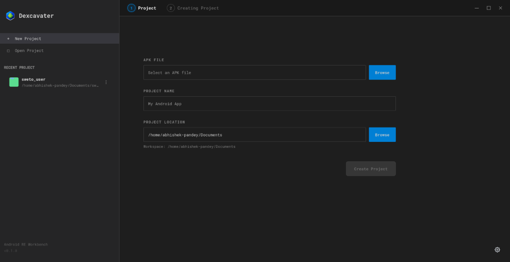
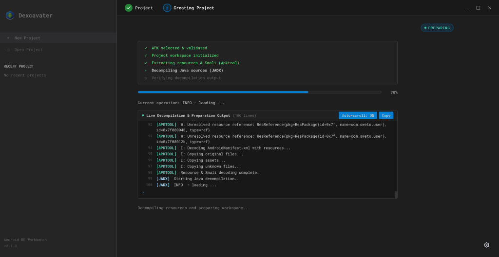
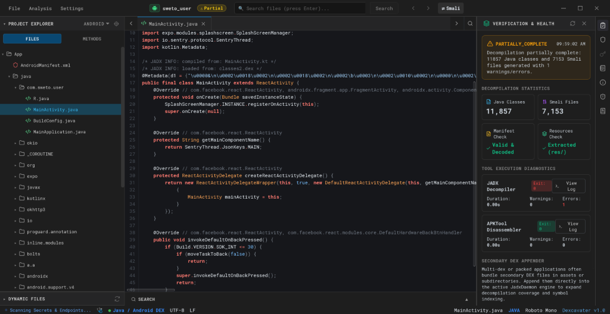
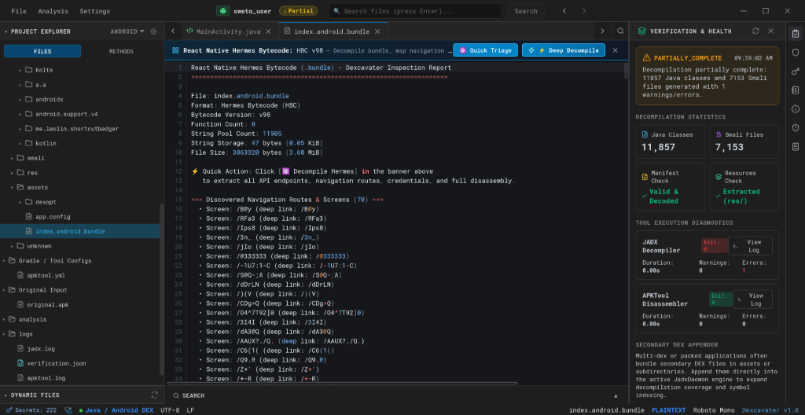
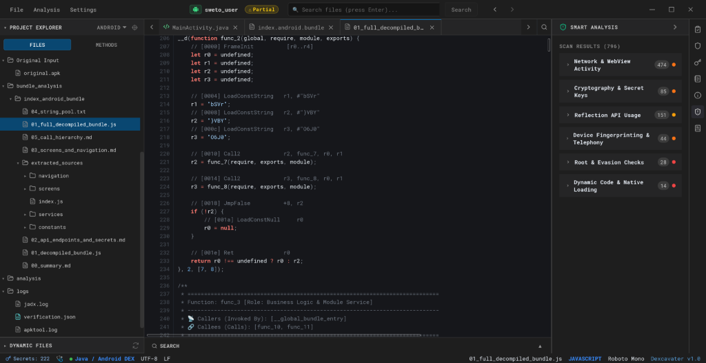
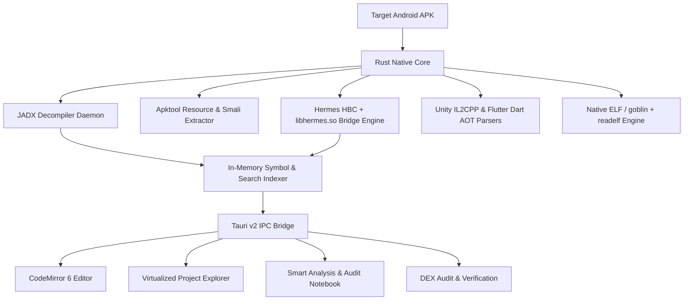

<div align="center">

# ⛏️ DEXCAVATER

### Unified Android Reverse Engineering & Pure-Static Multi-Framework Workbench

[](https://github.com/BabaAndroid/dexcavater-releases/releases/latest)
[](https://github.com/BabaAndroid/dexcavater-releases/releases/latest)
[](https://www.rust-lang.org/)
[](https://codemirror.net/)
[](https://github.com/BabaAndroid/dexcavater-releases)
[](https://github.com/BabaAndroid/dexcavater-releases)

<br/>

**Dexcavater** is a cross-platform desktop environment built for Android reverse engineers, malware analysts, and mobile application security testers (MAST).

*Stop juggling disconnected CLI tools and sluggish GUI frontends.* Dexcavater unifies Android DEX decompilation, Smali disassembly, React Native Hermes + `libhermes.so` native bridge analysis, Unity IL2CPP, Flutter Dart AOT, and Native ELF shared library auditing into a single, pure-static, offline desktop workbench.

---

[**Download Latest Release**](https://github.com/BabaAndroid/dexcavater-releases/releases/latest) • [**Key Features**](#-key-features) • [**Visual Showcase**](#-visual-showcase) • [**Installation**](#-installation-guide) • [**Architecture**](#-architecture--design) • [**Report Issues**](https://github.com/BabaAndroid/dexcavater-releases/issues)

---

</div>

<br/>

## ⚡ Why Dexcavater?

Modern Android applications are multi-layered binaries combining:
- **Dalvik/ART Bytecode** (`classes*.dex`, multi-dex, embedded DEX assets)
- **React Native & Hermes Bytecode** (`index.android.bundle` + `libhermes.so` / JSI / TurboModules)
- **Unity IL2CPP & Flutter Dart AOT** (`global-metadata.dat` + `libil2cpp.so`, `libapp.so`)
- **Native Shared Libraries** (`.so` ELF binaries with JNI bridges and hardening flags)

Traditional workflows force analysts to switch between JADX-GUI, Apktool CLI, separate Hermes scripts, `readelf`/disassemblers for native libraries, and manual grep loops for credential hunting.

**Dexcavater unifies these into one pure-static Rust + Tauri v2 desktop workbench** — running completely offline with **zero AI/LLM dependencies** and asynchronous background workers so the Project Tree and CodeMirror 6 editor stay responsive.

<br/>

---

## 📦 Direct Downloads

Grab the pre-compiled installer for your operating system from the [**Official Releases Hub**](https://github.com/BabaAndroid/dexcavater-releases/releases/latest):

| Platform | Target OS | Package Format | Direct Download |
| :--- | :--- | :--- | :--- |
| 🐧 **Linux** | Ubuntu, Debian, Kali, Linux Mint | `.deb` (64-bit `amd64`) | [⬇️ **Download .deb**](https://github.com/BabaAndroid/dexcavater-releases/releases/latest) |
| 🎩 **Linux** | Fedora, RHEL, CentOS, openSUSE | `.rpm` (64-bit `x86_64`) | [⬇️ **Download .rpm**](https://github.com/BabaAndroid/dexcavater-releases/releases/latest) |
| 🪟 **Windows** | Windows 10 / Windows 11 | `.exe` (NSIS Setup `x64`) | [⬇️ **Download .exe**](https://github.com/BabaAndroid/dexcavater-releases/releases/latest) |
| 🍎 **macOS** | Apple Silicon / Universal | `.dmg` | [⬇️ **Download .dmg**](https://github.com/BabaAndroid/dexcavater-releases/releases/latest) |

> [!TIP]
> **Integrity Verification**: Every release includes `SHA256SUMS.txt`. Verify your download before installing via `sha256sum -c SHA256SUMS.txt`.

<br/>

---

## 📸 Visual Showcase

<br/>

### 1️⃣ Frictionless Project Onboarding & Workspace Isolation
Select any Android APK, designate an isolated analysis workspace, and let Dexcavater set up structured directories, indexing, and recent project tracking.

<div align="center">
  <a href="https://raw.githubusercontent.com/BabaAndroid/dexcavater-releases/main/docs/screenshots/01_project_creation.png" target="_blank">
    
  </a>
  <p><em>Clean project setup with workspace isolation and recent project history.</em></p>
</div>

<br/>

### 2️⃣ Real-Time Multi-Stage Decompilation Pipeline
Dexcavater runs APK validation, Apktool resource/Smali decoding, and JADX Java decompilation with real-time diagnostic log streaming and progress tracking.

<div align="center">
  <a href="https://raw.githubusercontent.com/BabaAndroid/dexcavater-releases/main/docs/screenshots/02_live_preparation_pipeline.png" target="_blank">
    
  </a>
  <p><em>Live pipeline tracking: APK validation, Apktool resource decoding, and JADX Java decompilation.</em></p>
</div>

<br/>

### 3️⃣ CodeMirror 6 Editor & Verification Health Dashboard
Built on **CodeMirror 6** and a virtualized project explorer, Dexcavater keeps navigation smooth across large APK codebases. The **Verification & Health** panel reports decompilation coverage across Java/Smali sources and supports auditing primary and secondary DEX files.

<div align="center">
  <a href="https://raw.githubusercontent.com/BabaAndroid/dexcavater-releases/main/docs/screenshots/03_workbench_java_editor.png" target="_blank">
    
  </a>
  <p><em>CodeMirror 6 Java editor, package hierarchy, and decompilation health diagnostics.</em></p>
</div>

<br/>

### 4️⃣ React Native Hermes Bytecode (HBC) & `libhermes.so` Native Bridge
Dexcavater's **Hermes Studio** parses HBC bytecode (`v94–v98`) with a rich static fallback for `v99+` (header, function directory, structured string literals), extracts string pools and React Navigation routes, and inspects `libhermes*.so` / companion RN `.so` libraries (`05_libhermes_vm_and_native_bridge.md`) for VM entry points, JSI/TurboModule symbols, Smali `@ReactMethod` bridges, and Inspector/CDP exposure.

<div align="center">
  <a href="https://raw.githubusercontent.com/BabaAndroid/dexcavater-releases/main/docs/screenshots/04_hermes_bytecode_triage.png" target="_blank">
    
  </a>
  <p><em>Hermes Bytecode triage: string pool extraction, function counts, and auto-discovered navigation routes.</em></p>
</div>

<br/>

### 5️⃣ Deep Hermes JS Reconstruction & Smart Analysis
With **Deep Decompile**, Dexcavater reconstructs readable JavaScript modules (`decompiled_src/`), restores inline Base64 sourcemaps (`original_sources/`), and pairs with **Smart Analysis**, **Secrets Harvester**, and the **Audit Notebook** for security triage.

<div align="center">
  <a href="https://raw.githubusercontent.com/BabaAndroid/dexcavater-releases/main/docs/screenshots/05_hermes_deep_decompilation_smart_analysis.png" target="_blank">
    
  </a>
  <p><em>Decompiled Hermes JavaScript alongside Smart Analysis security findings.</em></p>
</div>

<br/>

---

## ✨ Key Features

### 🚀 High-Speed Code & AST Navigation
- **CodeMirror 6 Editor**: Syntax highlighting for Java, Smali, JavaScript, and XML.
- **Pure-Rust In-Memory Indexing**: Fast file search, regex search, X-Ray symbol graphs, and forward/backward call tracing.
- **Package Hierarchy & Virtualized Tree**: Switch between Android package layout and filesystem view without freezing on thousands of files.
- **Undecompiled DEX Auditor**: Audits primary `classes*.dex` and embedded DEX files for coverage gaps.

### ⚛️ React Native, Hermes & `libhermes.so` Studio
- **HBC Bytecode Decompiler & `v99+` Fallback**: Lifts `v94–v98` opcodes into readable JS and extracts header metadata, function directory entries, and structured string literals for `v99+`.
- **`libhermes.so` VM & Native Bridge Profiler (`05_libhermes_vm_and_native_bridge.md`)**: Pure-Rust ELF + C++ demangling (`goblin`, `cpp_demangle`) extracting VM entry point virtual addresses (`makeHermesRuntime`, `evaluateJavaScript`, `prepareJavaScript`, `BCProviderFromBuffer`), JSI `HostFunction`/`HostObject` & `TurboModule` symbols, Smali `ReactContextBaseJavaModule` / `@ReactMethod` cross-references, and Hermes Inspector/CDP exposure checks.
- **Pre-Flight Decompression & Sourcemaps**: Handles GZIP, ZLIB, and ZIP-wrapped bundles in memory and extracts inline Base64 sourcemaps.

### 🎮 Unity IL2CPP & 🎯 Flutter Dart AOT Studios
- **Unity IL2CPP Studio**: Reconstructs C# class/metadata structures from `global-metadata.dat` + `libil2cpp.so`, with graceful diagnostic reporting (`metadata/global_metadata_info.json`) when `global-metadata.dat` is encrypted or obfuscated.
- **Flutter / Dart AOT Studio**: Pure-Rust `libapp.so` snapshot inspection (`_kDartIsolateSnapshotData`, `_kDartIsolateSnapshotInstructions`) to recover Dart classes, libraries, and meaningful strings.

### 🛡️ Security Auditing & Native ELF Inspection
- **Secrets & Endpoints Harvester**: Scans Java, Smali, Hermes, and native outputs for hardcoded secrets, tokens, and backend URLs.
- **Attack Surface & Audit Notebook**: Maps exported Android components and persists triaged findings locally per project.
- **Native ELF Studio**: Inspects ELF headers, sections, dynamic/exported symbols, dependencies, and binary hardening mitigations.

<br/>

---

## 🚀 Installation Guide

### 🐧 Ubuntu / Debian / Kali / Linux Mint
```bash
# 1. Download the .deb installer from Releases
# e.g. dexcavater_1.0.0-beta.1_amd64.deb

# 2. Install the package
sudo dpkg -i dexcavater_1.0.0-beta.1_amd64.deb

# 3. Resolve any missing system libraries (if prompted)
sudo apt-get install -f
```

### 🎩 Fedora / RHEL / openSUSE
```bash
# Install via RPM package manager
sudo rpm -ivh dexcavater-1.0.0-1.x86_64.rpm
```

### 🪟 Windows (10 / 11)
1. Download the `.exe` NSIS installer from [Releases](https://github.com/BabaAndroid/dexcavater-releases/releases/latest).
2. Double-click to run the setup wizard.
3. Launch **Dexcavater** from your Start Menu or Desktop.

### 🍎 macOS (Apple Silicon & Intel)
1. Download the `.dmg` disk image from [Releases](https://github.com/BabaAndroid/dexcavater-releases/releases/latest).
2. Open the `.dmg` and drag **Dexcavater** to `/Applications`.
3. Launch Dexcavater from Spotlight or Launchpad.

### ☕ Runtime Prerequisite
- **Java JDK 17+** must be installed on the host machine for JADX and Apktool.

<br/>

---

## 🏗️ Architecture & Design



| Dimension | Legacy Multi-Tool Workflows | **Dexcavater** |
| :--- | :--- | :--- |
| **Runtime Architecture** | Separate Java / Python / CLI tools | **Unified Rust + Tauri v2 Desktop App** |
| **Hermes + Native Bridge** | Separate HBC scripts + manual `readelf` | **Built-in HBC Parser + `libhermes.so` / Smali Correlator** |
| **Multi-Framework Support** | Java/Smali only | **DEX + Hermes + Unity IL2CPP + Flutter Dart AOT + ELF** |
| **UI Responsiveness** | Blocks on large files / trees | **Async `spawn_blocking` + Virtualized Tree + CodeMirror 6** |
| **Privacy & Execution** | Varies | **100% Pure-Static & Offline (Zero AI / Cloud Calls)** |

<br/>

---

## 🔒 Security, Integrity & Ethics

- **Authorized Auditing**: Dexcavater is built for legitimate developers, security researchers, penetration testers, and analysts to audit applications they own or have explicit authorization to inspect.
- **Offline-First & Pure-Static**: Dexcavater operates locally on your machine with no AI/cloud telemetry — your APKs, source code, and audit findings stay on disk.
- **Verification Hashes**: Always verify downloaded packages against `SHA256SUMS.txt` before installation.

<br/>

---

## 🤝 Community & Support

- **Bug Reports & Feature Requests**: File an issue on the [Issue Tracker](https://github.com/BabaAndroid/dexcavater-releases/issues).
- **Public Releases**: Watch the [Releases Repository](https://github.com/BabaAndroid/dexcavater-releases) for new binary drops and platform updates.

<br/>

<div align="center">

**Pure-Static Android & Multi-Framework Reverse Engineering Workbench.**  
*Dexcavater — Unearth the code within.*

</div>
