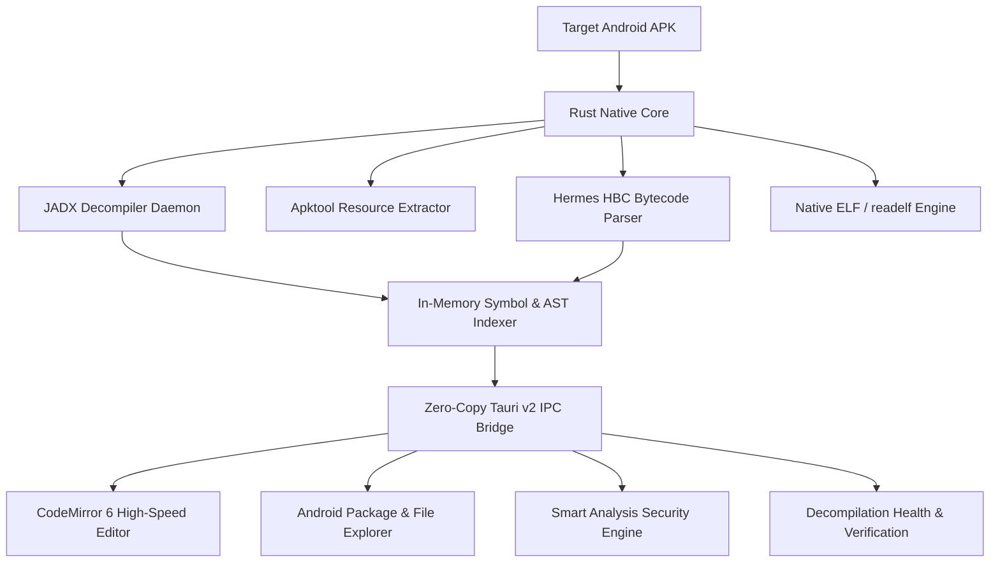

<div align="center">

# ⛏️ DEXCAVATER

### The Next-Generation Unified Android Reverse Engineering & Binary Intelligence Workbench

[](https://github.com/BabaAndroid/dexcavater-releases/releases/latest)
[](https://github.com/BabaAndroid/dexcavater-releases/releases/latest)
[](https://www.rust-lang.org/)
[](https://codemirror.net/)
[](https://github.com/BabaAndroid/dexcavater-releases)
[](https://github.com/BabaAndroid/dexcavater-releases)

<br/>

**Dexcavater** is an ultra-fast, developer-grade desktop environment purpose-built for Android reverse engineers, malware analysts, and mobile application security testers (MAST). 

*Stop juggling five disconnected CLI tools and sluggish GUI frontends.* Dexcavater unifies DEX decompilation, Smali disassembly, React Native Hermes bytecode reconstruction, native ELF shared library auditing, and automated vulnerability scanning into a single, cohesive, high-performance IDE.

---

[**Download Latest Release**](https://github.com/BabaAndroid/dexcavater-releases/releases/latest) • [**Key Features**](#-key-features) • [**Visual Showcase**](#-visual-showcase) • [**Installation**](#-installation-guide) • [**Architecture**](#-architecture--performance) • [**Report Issues**](https://github.com/BabaAndroid/dexcavater-releases/issues)

---

</div>

<br/>

## ⚡ Why Dexcavater?

Modern Android applications are no longer simple Java packages. They are multi-layered binaries combining:
- **Dalvik/ART Bytecode** (`classes.dex`, multi-dex, dynamic runtime loaders)
- **Hybrid JavaScript Runtimes** (React Native compiled into optimized **Hermes Bytecode - HBC**)
- **Native Shared Libraries** (`.so` ELF binaries with JNI bridges and anti-tamper logic)
- **Complex Resources & Obfuscated Assets**

Traditional workflows force analysts to switch between JADX-GUI, Apktool CLI, custom Python scripts for Hermes, `readelf`/Ghidra for native libraries, and manual grep loops for credential hunting. 

**Dexcavater eliminates toolchain fragmentation.** Powered by a high-throughput **Rust** engine and **Tauri v2**, Dexcavater gives you sub-5ms AST symbol queries, instant file loading, and deep automated triage in a sleek, cyber-engineered dark interface.

<br/>

---

## 📦 Direct Downloads

Grab the pre-compiled binary for your operating system directly from our [**Official Releases Hub**](https://github.com/BabaAndroid/dexcavater-releases/releases/latest):

| Platform | Target OS | Package Format | Direct Download Link |
| :--- | :--- | :--- | :--- |
| 🐧 **Linux** | Ubuntu, Debian, Kali, Linux Mint | `.deb` (64-bit) | [⬇️ **Download .deb**](https://github.com/BabaAndroid/dexcavater-releases/releases/latest) |
| 🎩 **Linux** | Fedora, RHEL, CentOS, Rocky | `.rpm` (64-bit) | [⬇️ **Download .rpm**](https://github.com/BabaAndroid/dexcavater-releases/releases/latest) |
| 🪟 **Windows** | Windows 10 / Windows 11 | `.exe` (NSIS Setup) | [⬇️ **Download .exe**](https://github.com/BabaAndroid/dexcavater-releases/releases/latest) |
| 🍎 **macOS** | macOS Ventura, Sonoma, Sequoia | `.dmg` (Universal) | [⬇️ **Download .dmg**](https://github.com/BabaAndroid/dexcavater-releases/releases/latest) |

> [!TIP]
> **Integrity Verification**: Every release comes signed with cryptographic hashes. Download `SHA256SUMS.txt` alongside your installer and verify via `sha256sum -c SHA256SUMS.txt`.

<br/>

---

## 📸 Visual Showcase

Experience the precision engineering of Dexcavater through real-world analysis workflows:

<br/>

### 1️⃣ Frictionless Project Onboarding & Workspace Isolation
Select any Android APK, designate an isolated analysis workspace, and let Dexcavater set up structured directories, cached indexing, and recent project tracking with zero configuration overhead.

<div align="center">
  <a href="https://raw.githubusercontent.com/BabaAndroid/dexcavater-releases/main/docs/screenshots/01_project_creation.png" target="_blank">
    
  </a>
  <p><em>Clean, intuitive project setup with workspace sandboxing and recent project history.</em></p>
</div>

<br/>

### 2️⃣ Real-Time Multi-Stage Decompilation Pipeline
Watch every stage of extraction execute with millisecond precision. Dexcavater runs APK validation, Apktool resource decoding, and JADX Java decompilation concurrently, streaming color-coded diagnostic logs and progress feedback in real time.

<div align="center">
  <a href="https://raw.githubusercontent.com/BabaAndroid/dexcavater-releases/main/docs/screenshots/02_live_preparation_pipeline.png" target="_blank">
    
  </a>
  <p><em>Live pipeline tracking: APK validation, Apktool resource decoding, and JADX Java decompilation with live log streaming.</em></p>
</div>

<br/>

### 3️⃣ Developer-Grade CodeMirror 6 Editor & Verification Health Dashboard
Say goodbye to sluggish, bloated IDEs. Built on **CodeMirror 6**, Dexcavater renders 10,000+ line classes instantaneously with syntax highlighting, line folding, and breadcrumbs. The **Verification & Health** panel aggregates real-time metrics across all decompiled classes (11,857+ Java sources, 7,153+ Smali files) with one-click secondary DEX appending.

<div align="center">
  <a href="https://raw.githubusercontent.com/BabaAndroid/dexcavater-releases/main/docs/screenshots/03_workbench_java_editor.png" target="_blank">
    
  </a>
  <p><em>High-speed CodeMirror 6 Java editor, intelligent package hierarchy, and live decompilation diagnostics.</em></p>
</div>

<br/>

### 4️⃣ React Native Hermes Bytecode (HBC) Engine & Instant Triage
Reverse engineering modern React Native applications is historically tedious. Dexcavater features a dedicated **Hermes Bytecode Engine**. Simply open `index.android.bundle` to instantly parse bytecode version (e.g. HBC v98), extract string pools (11,900+ strings), and automatically discover all internal **navigation routes and deep links** without running the app.

<div align="center">
  <a href="https://raw.githubusercontent.com/BabaAndroid/dexcavater-releases/main/docs/screenshots/04_hermes_bytecode_triage.png" target="_blank">
    
  </a>
  <p><em>Hermes Bytecode (HBC v98) triage: string pool extraction, function counts, and 70+ auto-discovered navigation routes.</em></p>
</div>

<br/>

### 5️⃣ Deep Hermes JS Decompilation & Automated Smart Analysis (796+ Findings)
With a single click on **Deep Decompile**, Dexcavater reconstructs formatted, readable JavaScript code with annotated caller/callee graphs and module role inference. Concurrently, the **Smart Analysis** security engine audits the bundle, cataloging hundreds of high-risk security primitives into categorized security intelligence.

<div align="center">
  <a href="https://raw.githubusercontent.com/BabaAndroid/dexcavater-releases/main/docs/screenshots/05_hermes_deep_decompilation_smart_analysis.png" target="_blank">
    
  </a>
  <p><em>Decompiled Hermes JavaScript with annotated caller/callee graphs alongside 796 classified Smart Analysis security findings.</em></p>
</div>

<br/>

---

## ✨ Key Features

### 🚀 High-Speed Code & AST Navigation
- **CodeMirror 6 Editor**: Instantaneous syntax highlighting for Java, Smali, JavaScript (ES6+), and XML.
- **Sub-5ms Symbol Resolution**: Pure Rust in-memory AST indexing eliminates sluggish IPC loops.
- **Package Hierarchy vs. Project Tree**: Toggle instantly between Android package perspective (`com.example.app`) and physical filesystem layout.
- **Secondary DEX Appender**: Effortlessly append multi-dex splits, dynamic feature modules, or runtime-dropped DEX files directly into the active decompiler session.

### ⚛️ First-Class React Native & Hermes Support
- **HBC Bytecode Disassembler**: Inspect bytecode headers, instruction streams, and metadata across modern Hermes versions.
- **Automated String Pool Harvesting**: Extract and decrypt embedded endpoints, tokens, and asset URLs.
- **Deep JS Reconstruction**: Turn raw opcode registers into readable JavaScript modules with reconstructed `require(...)` structures.
- **Route & Screen Mapping**: Automatically identify React Navigation / Expo Router screens and deep links.

### 🛡️ Automated Smart Analysis & Secrets Harvester
Audit application risk in seconds with automated rule-based and heuristics scanners:
- **🌐 Network & WebView Activity**: Detect hidden REST endpoints, insecure cleartext HTTP requests, WebView JavaScript interfaces, and SSL pinning evasion.
- **🔐 Cryptography & Secret Keys**: Flag hardcoded AES/RSA keys, initialization vectors, API tokens, and weak hashing algorithms (MD5/SHA1).
- **🪞 Reflection API Usage**: Identify dynamic method invocations (`java.lang.reflect`) used to hide malicious payloads.
- **📱 Device Fingerprinting & Telephony**: Track IMEI/IMSI access, MAC address queries, and hardware identifier harvesting.
- **🛡️ Root & Tamper Evasion**: Uncover Magisk, SuperSU, and sandbox detection checks.
- **⚡ Dynamic Code Loading**: Trace DexClassLoader and native library loading (`System.loadLibrary`).

### 🧬 Native ELF & Shared Library Inspection
- **Built-in `readelf` Engine**: Inspect ELF headers, dynamic sections, program segments, and imported/exported symbols in `.so` binaries.
- **JNI Bridge Mapping**: Automatically correlate native C/C++ function signatures (`Java_com_package_class_method`) directly with their Java `native` declarations.

<br/>

---

## 🚀 Installation Guide

### 🐧 Ubuntu / Debian / Kali / Linux Mint
```bash
# 1. Download the latest .deb installer
wget https://github.com/BabaAndroid/dexcavater-releases/releases/latest/download/dexcavater_0.1.0_amd64.deb

# 2. Install the package
sudo dpkg -i dexcavater_0.1.0_amd64.deb

# 3. Resolve any missing system libraries (if prompted)
sudo apt-get install -f
```

### 🎩 Fedora / RHEL / Rocky Linux
```bash
# Install via RPM package manager
sudo rpm -ivh dexcavater-0.1.0-1.x86_64.rpm
```

### 🪟 Windows (10 / 11)
1. Download `dexcavater_0.1.0_x64-setup.exe` from [Releases](https://github.com/BabaAndroid/dexcavater-releases/releases/latest).
2. Double-click to run the setup wizard (verified NSIS installer).
3. Launch **Dexcavater** from your Start Menu or Desktop.

### 🍎 macOS (Apple Silicon & Intel)
1. Download `dexcavater_0.1.0_universal.dmg` from [Releases](https://github.com/BabaAndroid/dexcavater-releases/releases/latest).
2. Open the `.dmg` and drag **Dexcavater** to your `/Applications` folder.
3. Launch Dexcavater from Spotlight or Launchpad.

<br/>

---

## 🏗️ Architecture & Performance

Dexcavater was architected to break free from the performance bottlenecks of legacy reverse engineering GUIs:



| Dimension | Legacy Toolchains | Electron-Based Tools | **Dexcavater** |
| :--- | :--- | :--- | :--- |
| **Startup Time** | 4 - 8 seconds | 5 - 12 seconds | **< 600 ms** |
| **Idle Memory Footprint** | ~650 MB - 1.2 GB | 1.1 GB - 2.5 GB | **~110 MB** |
| **Symbol Navigation Latency** | 1,500 ms - 3,000 ms | 800 ms - 2,000 ms | **~5 ms (In-Memory Rust AST)** |
| **React Native Hermes HBC** | ❌ Requires CLI scripts | ❌ Partial / Plugin | **✅ Built-in Native HBC Engine** |
| **Editor Performance** | Swing / Laggy TextArea | Monaco (Heavy) | **CodeMirror 6 (Optimized)** |

<br/>

---

## 🔒 Security, Integrity & Ethics

- **Authorized Auditing**: Dexcavater is engineered exclusively for legitimate software developers, security researchers, penetration testers, and academic forensic analysts to audit applications they own or have explicit authorization to inspect.
- **Hermetic & Offline-First**: Dexcavater operates 100% locally on your machine. Your APK binaries, proprietary source code, credentials, and reverse engineering logs are **never transmitted** to external cloud servers.
- **Verification Hashes**: Always verify downloaded installation packages against our official `SHA256SUMS.txt` cryptographic ledger before installation.

<br/>

---

## 🤝 Community & Support

- **Bug Reports & Feature Requests**: Found an edge-case APK or want to suggest an enhancement? Please file an issue on our [Issue Tracker](https://github.com/BabaAndroid/dexcavater-releases/issues).
- **Public Releases**: Follow the [Releases Repository](https://github.com/BabaAndroid/dexcavater-releases) to receive notifications for new binary drops and platform updates.

<br/>

<div align="center">

**Crafted with relentless attention to speed, precision, and engineering excellence.**  
*Dexcavater — Unearth the code within.*

</div>
